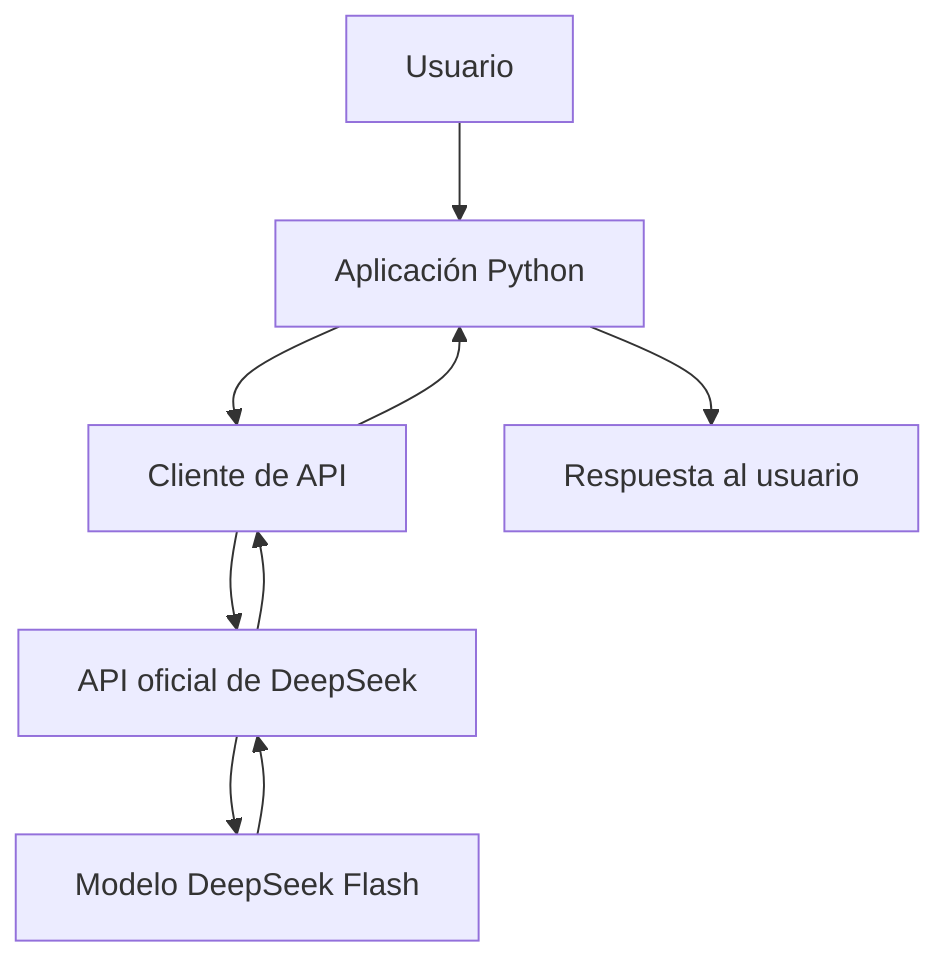

# Decisión de arquitectura: elección de modelo

## Modelo elegido

**DeepSeek Flash (`deepseek-flash`), mediante la API oficial de DeepSeek.**

Se selecciona como candidato principal para la aplicación debido a su rendimiento en las pruebas realizadas y a su costo estimado por solicitud. La decisión se basa en mediciones experimentales y una evaluación preliminar de la calidad de las respuestas.

## Diagrama de arquitectura

## Comparación de candidatos

Se compararon dos alternativas: GPT-4o mini mediante OpenRouter y DeepSeek Flash mediante la API oficial de DeepSeek.

| Indicador | GPT-4o mini vía OpenRouter | DeepSeek Flash vía DeepSeek |
| :---- | :---- | :---- |
| Latencia promedio | 8,18 segundos | 4,84 segundos |
| Latencia mínima | 5,84 segundos | 4,01 segundos |
| Latencia máxima | 12,45 segundos | 5,88 segundos |
| Pruebas de latencia | 6 | 6 |
| Evaluación preliminar de calidad | 18/20 | 20/20 |
| Costo por solicitud | Entre US\$ 0,00017355 y US\$ 0,00019275 en dos registros | Variable según tokens, caché y tarifa horaria |

**Costo estimado de DeepSeek Flash:** para una solicitud de referencia con 38 tokens de entrada sin caché y 417 tokens de salida, el costo calculado es de US\$ 0,00025590 en horas valle y US\$ 0,00051180 en horas punta, utilizando las tarifas consultadas el 22 de octubre de 2026\.

Fuente de precios: [Documentación oficial de tarifas de DeepSeek](https://api-docs.deepseek.com/quick_start/pricing/).

Los costos corresponden a estimaciones calculadas con las tarifas publicadas, no a importes de facturación confirmados.

## Justificación

Se elige DeepSeek Flash como candidato principal por los siguientes motivos:

- **Latencia:** registró un promedio de 4,84 segundos, inferior a los 8,18 segundos de GPT-4o mini mediante OpenRouter en las pruebas realizadas.  
- **Calidad:** obtuvo 20/20 en la evaluación cualitativa preliminar, frente a 18/20 de GPT-4o mini. Esta evaluación se realizó con una sola pregunta, por lo que no permite establecer una superioridad general del modelo.  
- **Costo:** dispone de tarifas diferenciadas según el consumo de tokens, el uso de caché y el horario. Para estimar el costo de operación se deben considerar estas variables.  
- **Integración:** se comprobó que la aplicación Python puede comunicarse con la API oficial de DeepSeek y obtener respuestas correctamente.

Los resultados son experimentales y corresponden a las condiciones de las pruebas realizadas. La latencia y el costo pueden variar según la solicitud, la red, la carga del servicio y las tarifas vigentes.

## Alternativa descartada y por qué

Se descarta GPT-4o mini mediante OpenRouter como opción principal, aunque sigue siendo una alternativa viable.

En las pruebas realizadas presentó una latencia promedio superior a la de DeepSeek Flash. Además, su puntuación de calidad fue ligeramente inferior en la evaluación preliminar.

Esta decisión no implica que GPT-4o mini sea inferior en todos los escenarios. La comparación se limita a los modelos, proveedores, pregunta y condiciones evaluadas en este experimento.  
